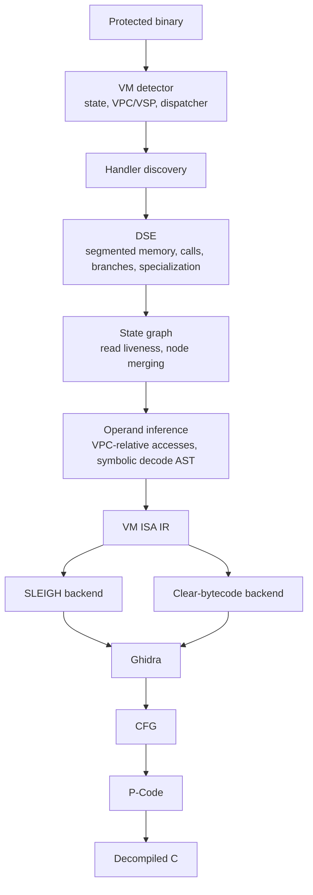

# Target architecture

The target pipeline follows the separation in this diagram:

## Current implementation

| Stage | Current code | Status |
| --- | --- | --- |
| VM detection | `vmspec/config.py` | VM state and dispatcher ranges are supplied by a frontend. Automatic detection is pending; the DBIN-specific frontend lives in private `vmspec-tests`. |
| Handler discovery | Frontend-provided metadata | Finding a dispatcher/table in an unknown binary is pending. DBIN table extraction is kept in the private test repository. |
| DSE | `vmspec/dse.py`, `vmspec/memory.py` | Symbolic branches and ordered events use path-local memory. Tracked 32-bit register writes are captured. Direct in-binary calls are analyzed inline for concrete targets and contexts; external or symbolic calls fail explicitly. Unique context values are concretized above 100 active states with a recorded guard. |
| State graph | `vmspec/state_graph.py` | Removes unused reads and merges nodes with their guards. Stores are retained where alias safety is unknown. |
| Operand inference | `vmspec/ir_lowering.py` | Handles multiple contiguous VPC-relative reads of 1, 2, or 4 bytes when each reaches an effect or branch. It records decoder expressions and instruction length in IR. Gapped, overlapping, and ambiguous layouts remain unsupported. |
| VM ISA IR | `vmspec/ir.py` | Implemented as immutable, typed, JSON-serializable Python data. It has ordered blocks, branches, memory reads/writes, calls, context updates and expression trees. |
| SLEIGH backend | `vmspec/sleigh_gen.py` | Consumes only the IR. Emits the supported expression, branch, register-write, and contiguous operand subset; requires 8-bit opcodes, 32-bit addresses/registers, and little-endian effects. Other operand layouts raise an error. |
| Clear-bytecode backend | Not in the public core | The DBIN-specific clear-image path and manual semantics are in private `vmspec-tests`; no IR-based clear-bytecode backend exists yet. |
| Ghidra, CFG, P-Code, C | SLEIGH backend; private DBIN harness | The public repository has one synthetic branch-equivalence fixture. Full CFG recovery and C decompilation have not been demonstrated. |

The two output paths currently differ: the core analysis pipeline creates IR
and feeds frontend-provided opcode encodings to SLEIGH. The DBIN-specific
clear-image workflow and manual VM interpreter are isolated in private
`vmspec-tests`. A generic clear-bytecode backend remains future work.

## Boundary contracts

- Detector output is `VMState` plus handler/dispatcher metadata. The current
  config is that contract; it is not an automatic detector.
- DSE output is an ordered state tree. It must either preserve an operation
  and its guard or report the unsupported case.
- State-graph output keeps control-flow guards and removes a read only when
  its value is unused.
- Operand inference should produce an `Operand` with its byte offset, width
  and decoded-value `Expr`, and set `Encoding.length` only when the complete
  length is known. Missing evidence remains `None`.
- The IR is the boundary for every future backend. No angr state, claripy AST,
  or sample handler offset belongs in an `Instruction`.
- Each backend declares its supported IR subset and rejects unsupported
  instructions. A generated listing is not evidence of complete semantics.

## Next implementation step

Generalize operand recovery across paths and multiple reads, and bind the
expression's native context inputs through frontend metadata. Keep ambiguous
layouts unresolved and compare inferred decode expressions with the existing
sample decoder as an oracle. The current basic inference and SLEIGH token path
are covered by `tests/test_ir.py`.
